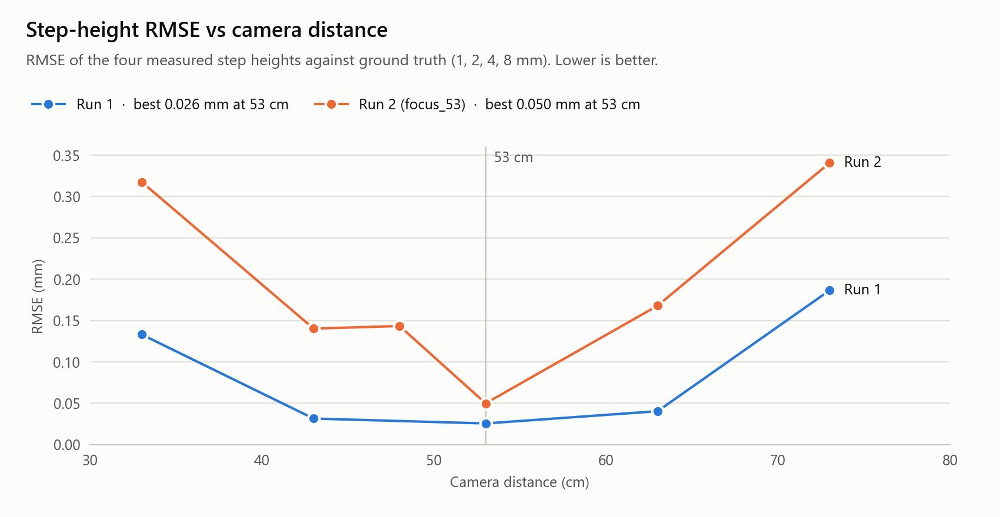
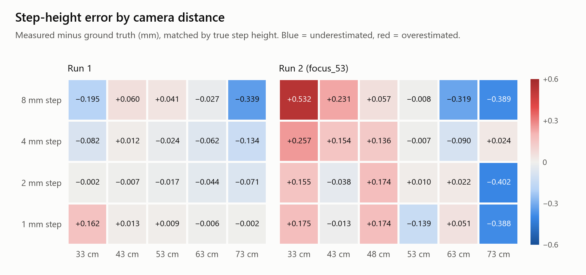
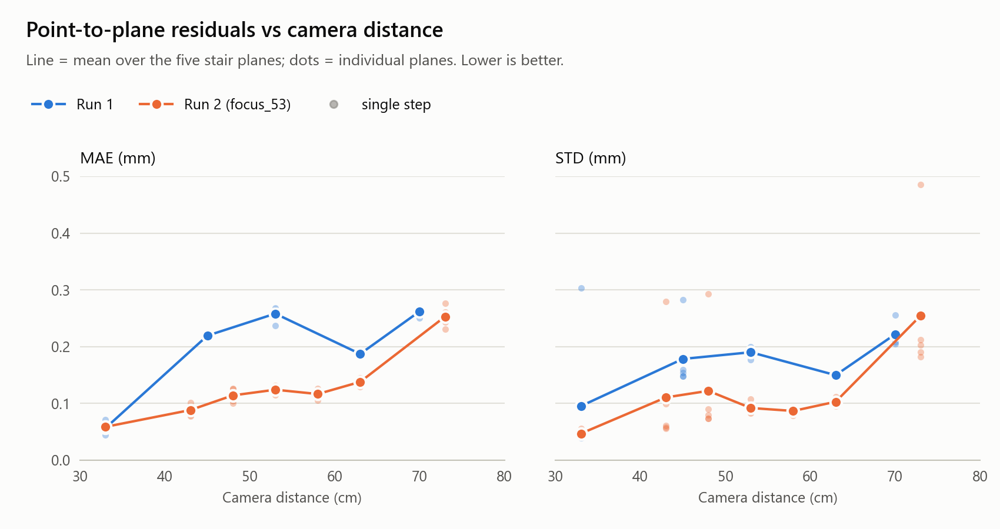
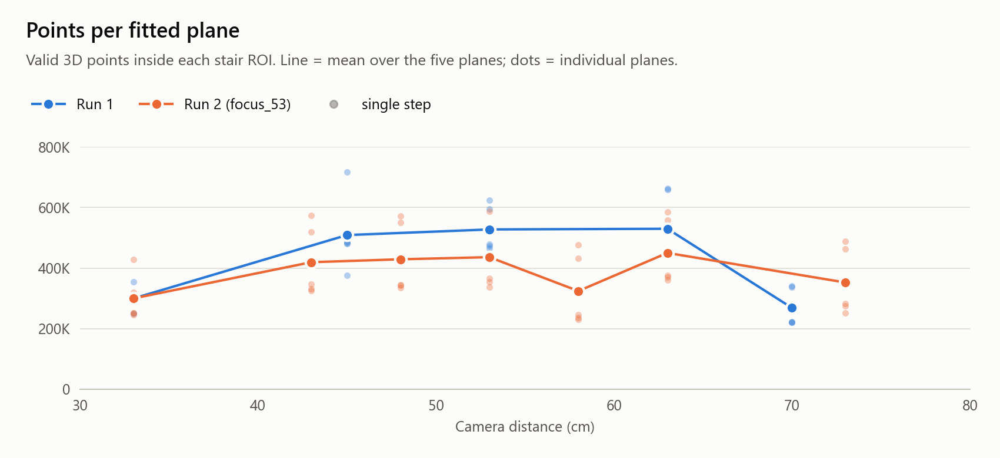

Evaluation of 3D camera accuracy using RGB images and point-cloud data. The project performs ROI-based surface segmentation, SVD plane fitting, plane-to-plane distance measurement, and point-to-plane error analysis to evaluate depth accuracy and surface noise at different camera distances.

**Camera:** Structured light camera · **Target:** 5-step staircase with 1, 2, 4 and 8 mm step heights · **Distances:** 33–73 cm

<picture>
  <source media="(prefers-color-scheme: dark)" srcset="figures/step_height_rmse_dark.png">
  
</picture>

## Key findings

- **53 cm is the sweet spot.** It gives the lowest step-height RMSE in both runs (0.026 mm in Run 1, 0.050 mm in Run 2). In Run 1 the RMSE stays between 0.026 and 0.040 mm from 43 to 63 cm.
- **Accuracy drops at both ends of the range.** At 73 cm both runs underestimate the 8 mm step by 0.34–0.39 mm. At 33 cm Run 2 overestimates every step, by up to +0.53 mm.
- **Lowest noise is not the same as best accuracy.** Point-to-plane MAE is lowest at 33 cm in both runs (~0.06 mm), yet 33 cm has some of the worst step-height errors.
- **Surface noise grows with distance in Run 2.** Mean MAE rises from 0.059 mm at 33 cm to 0.253 mm at 73 cm.
- **A few planes dominate some STD averages.** For example, step 5 at 33 cm in Run 1 has an STD of 0.303 mm, while the other four planes are at or below 0.052 mm.

Run 1 is the measurement series tabulated in this README. Run 2 is a second series with finer distance steps, recorded in [focus_53.md](focus_53.md). In Run 2 the staircase is measured from the 8 mm step down, so the charts match the two runs by true step height rather than by step index.

## Repository structure

| Path | Description |
|---|---|
| [camera_test.py](camera_test.py) | Main pipeline: polygon ROI masking → SVD plane fit → point-to-plane residuals → step heights |
| [config/config.yaml](config/config.yaml) | Stair ROI polygons (RGB pixel coordinates) for each dataset |
| [plot_results.py](plot_results.py) | Regenerates every chart in `figures/` from the CSVs in `results/` |
| [results/](results/) | All result tables as CSV: step heights, RMSE, MAE/STD and point counts per plane |
| [figures/](figures/) | Generated charts, in light and dark variants |
| [focus_53.md](focus_53.md) | Result tables for Run 2 |

## Getting started

```bash
pip install numpy pandas opencv-python pyyaml matplotlib
```

**Run the measurement pipeline.** Set `three_dp_path` and `config_path` inside `main()` in [camera_test.py](camera_test.py), then run:

```bash
python camera_test.py
```

The `.3dp` input holds one point per row: `x_img y_img x y z r g b`, with `x y z` in metres. The dataset name is taken from the folder two levels above the file. For example, `data_4_70cm/auto/scan.3dp` uses `data_4_70cm`, which must exist as a key in `config/config.yaml`. The script prints the point count, MAE and STD for each plane, followed by the four step heights.

**Regenerate the charts** after editing any CSV in `results/`:

```bash
python plot_results.py
```

The script also checks that each reported RMSE matches the step heights it is based on, and prints a warning if it doesn't.

## Plane to Plane Distance
Method 
1. Load RGB + 3D point cloud data
2. Crop each stair region using polygon ROI
3. Fit a plane to each stair surface using SVD
4. Compute perpendicular plane-to-plane distance
5. Compare measured distances with ground truth

The stair regions used for plane fitting and measurement were segmented manually on the RGB image, as shown below.

| Original RGB Image | Segmented Stair Regions |
|---|---|
| |   |

<picture>
  <source media="(prefers-color-scheme: dark)" srcset="figures/step_height_error_dark.png">
  
</picture>

Run 1 results:

| Cam Distance     | Step 1 → 2 (mm) | Step 2 → 3 (mm) | Step 3 → 4 (mm) | Step 4 → 5 (mm) | Error (RMSE mm) |
| ---------------- | --------------- | --------------- | --------------- | --------------- | --------------- |
| 33 cm            | 1.162           | 1.998           | 3.918           | 7.805           | **0.1332**      |
| 43 cm            | 1.013           | 1.993           | 4.012           | 8.060           | **0.0315**      |
| 53 cm            | 1.009           | 1.983           | 3.976           | 8.041           | **0.0256**      |
| 63 cm            | 0.994           | 1.956           | 3.938           | 7.973           | **0.0404**      |
| 73 cm            | 0.998           | 1.929           | 3.866           | 7.661           | **0.1865**      |
| **Ground Truth** | **1**           | **2**           | **4**           | **8**           |    0            |

See [focus_53.md](focus_53.md) for the Run 2 tables.

##  Point to Plane Error 
After fitting a plane to each segmented stair surface using SVD, the point-to-plane residuals are computed to evaluate surface fitting quality and noise consistency across different camera distances.

The error metrics are reported as:

- **MAE (Mean Absolute Error):** average deviation of points from the fitted plane
- **STD (Standard Deviation):** spread of point-to-plane residuals (surface noise)

<picture>
  <source media="(prefers-color-scheme: dark)" srcset="figures/point_to_plane_dark.png">
  
</picture>

<details>
<summary><b>Run 1: MAE and STD per step (mm)</b></summary>

MAE (mm)

| Step | 33 cm  | 45 cm  | 53 cm  | 63 cm  | 70 cm  |
| ---- | ------ | ------ | ------ | ------ | ------ |
| 1    | 0.071  | 0.216  | 0.265  | 0.189  | 0.267  |
| 2    | 0.052  | 0.215  | 0.268  | 0.186  | 0.268  |
| 3    | 0.044  | 0.222  | 0.265  | 0.185  | 0.266  |
| 4    | 0.051  | 0.224  | 0.256  | 0.186  | 0.259  |
| 5    | 0.065  | 0.220  | 0.237  | 0.190  | 0.251  |
| Avg  | 0.0566 | 0.2194 | 0.2582 | 0.1872 | 0.2622 |

STD (mm)

| Step | 33 cm  | 45 cm  | 53 cm  | 63 cm  | 70 cm  |
| ---- | ------ | ------ | ------ | ------ | ------ |
| 1    | 0.052  | 0.148  | 0.188  | 0.150  | 0.256  |
| 2    | 0.039  | 0.148  | 0.200  | 0.149  | 0.220  |
| 3    | 0.043  | 0.159  | 0.197  | 0.153  | 0.220  |
| 4    | 0.040  | 0.154  | 0.189  | 0.148  | 0.208  |
| 5    | 0.303  | 0.283  | 0.177  | 0.149  | 0.205  |
| Avg  | 0.0954 | 0.1784 | 0.1902 | 0.1498 | 0.2218 |

</details>

### Number of Points per Plane

<picture>
  <source media="(prefers-color-scheme: dark)" srcset="figures/points_per_plane_dark.png">
  
</picture>

Every plane fit is based on at least ~220K points, so each fit has plenty of data behind it at every distance.

<details>
<summary><b>Run 1: points per plane</b></summary>

| Step | 33 cm   | 45 cm   | 53 cm   | 63 cm   | 70 cm   |
| ---- | ------- | ------- | ------- | ------- | ------- |
| 1    | 355,066 | 375,926 | 594,901 | 663,107 | 340,247 |
| 2    | 290,838 | 486,701 | 473,272 | 443,501 | 223,287 |
| 3    | 291,383 | 481,151 | 465,429 | 440,647 | 221,181 |
| 4    | 310,155 | 482,891 | 478,708 | 441,686 | 221,604 |
| 5    | 250,614 | 717,197 | 624,440 | 658,972 | 336,100 |

</details>
